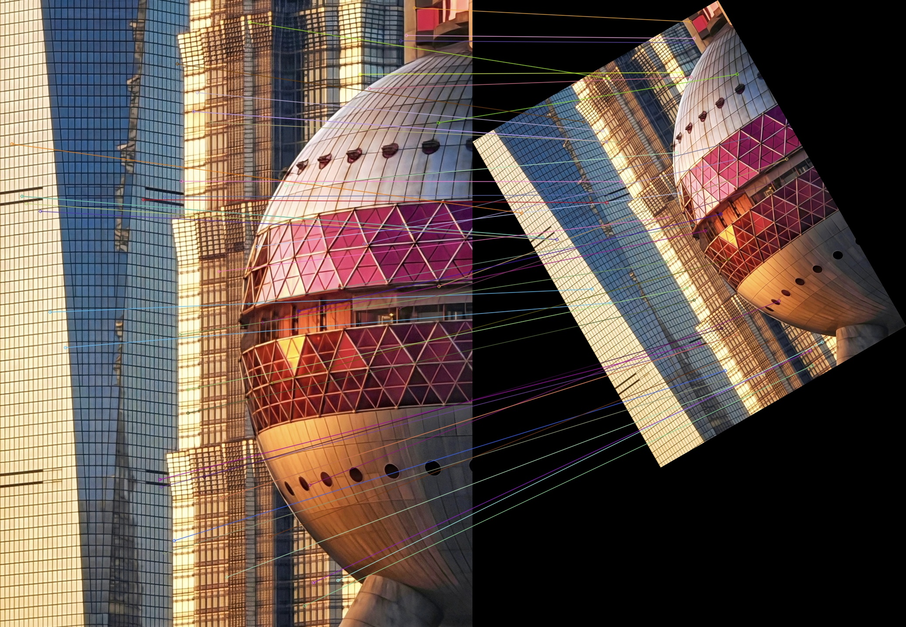

# 实验六 SIFT 特征提取与描述实验报告

## 一 实验目的

1. 理解 SIFT 的尺度空间极值检测、关键点定位、方向赋值和描述子生成过程。
2. 掌握 OpenCV 的 SIFT 特征提取与可视化接口。
3. 分析 `nfeatures`、`contrastThreshold` 和 `edgeThreshold` 对关键点的影响。
4. 验证 SIFT 对图像旋转和尺度变化的鲁棒性。
5. 将 SIFT 提取功能封装为可复用模块。

## 二 实验环境

- Python 3.12
- OpenCV 5.0.0
- NumPy
- Visual Studio Code
- Windows

## 三 实验原理

SIFT 是一种具有尺度不变性和旋转不变性的局部特征算法。其主要过程包括尺度空间极值检测、关键点精确定位、关键点方向赋值和描述子生成。

每个关键点邻域被划分为 4×4 个网格，每个网格统计 8 个方向的梯度直方图，因此描述子的维度为：

`4 × 4 × 8 = 128`

OpenCV 使用 `cv2.SIFT_create()` 创建 SIFT 对象，通过 `detectAndCompute()` 同时检测关键点并计算描述子。

## 四 基础特征提取

使用默认参数对实验图片提取 SIFT 特征，得到：

- 关键点数量：29512
- 描述子形状：`(29512, 128)`
- 描述子类型：`float32`

图中的圆圈表示关键点的尺度，圆内短线表示关键点的主方向。建筑物的窗格、边缘和纹理密集区域检测到了大量关键点。

## 五 参数对比实验

| 实验参数 | 关键点数量 | 描述子形状 |
|---|---:|---|
| 默认参数 | 29512 | `(29512, 128)` |
| `nfeatures=1000` | 1001 | `(1001, 128)` |
| `nfeatures=3000` | 3001 | `(3001, 128)` |
| `contrastThreshold=0.01` | 35061 | `(35061, 128)` |
| `contrastThreshold=0.04` | 29512 | `(29512, 128)` |
| `contrastThreshold=0.08` | 19103 | `(19103, 128)` |
| `edgeThreshold=5` | 23899 | `(23899, 128)` |
| `edgeThreshold=10` | 29512 | `(29512, 128)` |
| `edgeThreshold=20` | 37263 | `(37263, 128)` |

### 参数分析

`nfeatures` 用于限制优先保留的特征数量。实际结果可能略微超过设定值，因为同一位置可能根据多个主方向生成多个关键点。

`contrastThreshold` 越小，保留的低对比度关键点越多；阈值从 0.01 增加到 0.08 后，关键点数量从 35061 减少到 19103。

`edgeThreshold` 越大，边缘响应筛选条件越宽松，因此保留的关键点更多。本实验中关键点数量从 23899 增加到 37263。

## 六 旋转和尺度不变性验证

将原图旋转 30° 并缩放至 0.6 倍，同时扩大输出画布以避免主体被裁剪。

实验结果：

- 原图关键点数：29512
- 旋转缩放后关键点数：11189
- 通过 Lowe ratio test 的匹配数：6474
- 以原图关键点数为分母的匹配比例：0.219
- 匹配数占变换图关键点数的比例约为 57.9%

虽然以原图关键点数计算的匹配比例为 21.9%，但变换图因缩小而丢失了部分细小纹理。仍有 6474 个匹配通过 ratio test，说明 SIFT 在旋转和尺度发生变化后仍能保留大量可匹配特征。

## 七 代码组织与测试

SIFT 提取功能封装在 `src/features.py` 中，接口为：

`extract_sift(img, cfg=None) -> (keypoints, descriptors)`

测试内容包括：

1. 能否从有效图像中检测到关键点。
2. 描述子是否为 128 维 `float32` 矩阵。
3. 输入空图像时是否抛出错误。

3 项自动测试全部通过。

## 八 实验结论

本实验完成了 SIFT 关键点提取、128 维描述子计算、参数对比以及旋转和尺度不变性验证。实验结果表明，参数设置会明显影响关键点数量和分布；图像经过 30° 旋转和 0.6 倍缩放后仍保留了大量可靠匹配，说明 SIFT 对旋转和尺度变化具有较好的鲁棒性。